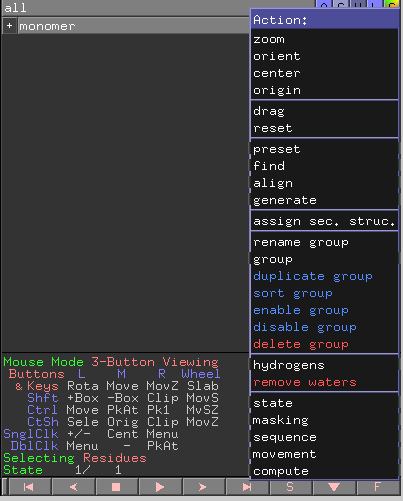
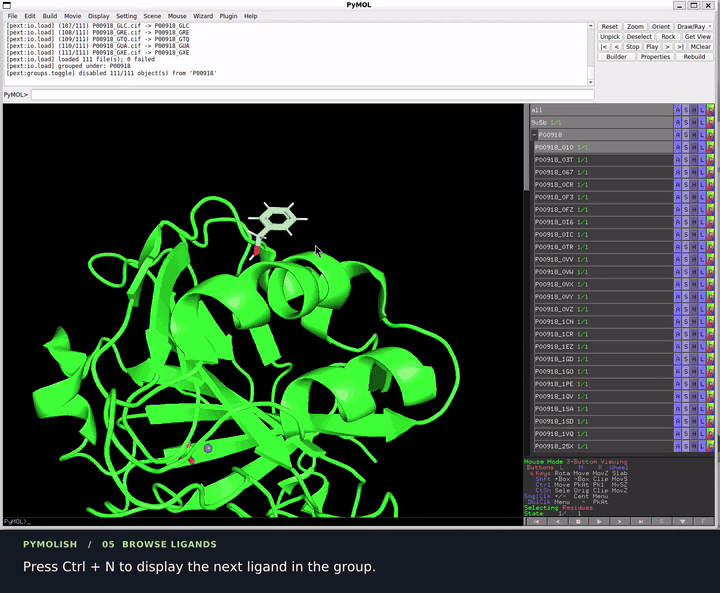

# GUI features

PyMOLish is primarily a command-line library: every command is typed into PyMOL's command line (or used from a script). A few of the most common group operations are also wired into PyMOL's graphical interface so you can reach them with the mouse or keyboard. More GUI integration is planned.

Everything on this page is demonstrated in the [video tour](https://www.youtube.com/watch?v=q6c24OJZzd4&t=50s): disabling a group and picking one ligand from the GUI (0:50), CTRL-N / CTRL-P (1:10), enable and disable group (1:28), sort group (1:37), and duplicate group (1:44).

## Group action menu

Groups in the object panel on the right get four new entries in their **A** (Action) menu. Click the **A** button next to a group name — or right-click the group — and look for the blue entries:

| Menu entry | Runs | What it does |
|------------|------|--------------|
| **duplicate group** | `copy_group` | Copies the group and all its members (members get a `_cpy` suffix) |
| **sort group** | `sort_group` | Sorts members alphabetically; click again to reverse the order |
| **enable group** | `group_enable` | Shows every member |
| **disable group** | `group_disable` | Hides every member |

The entries appear only for groups, not for plain molecules or selections. PyMOL's own entries (rename, delete, …) stay where they were.

## Keyboard shortcuts

| Key | Command | What it does |
|-----|---------|--------------|
| **CTRL-N** | `group_next` | Show the next member of the group, hide the others |
| **CTRL-P** | `group_previous` | Show the previous member |

These work on the currently active group. When a single group is loaded, nothing else is needed; with several groups, run `group_next <name>` once from the command line to pick the group, then keep using the keys.

## Everything else

All other functionality — loading, exporting, alignment, clustering, coloring, UniProt fetching — is available from the command line. See the [Quick start](quickstart.md) for a tour and the [command reference](commands/README.md) for details.
