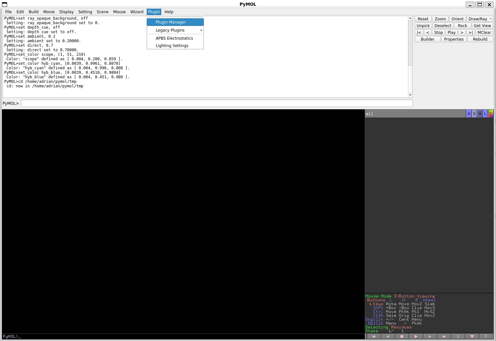
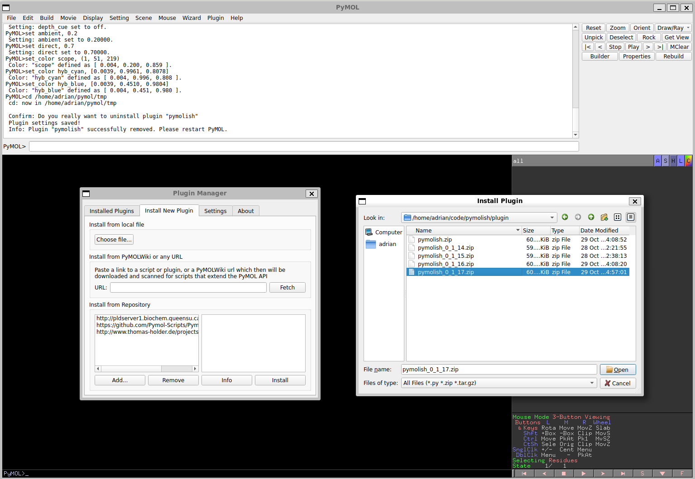

# Installing PyMOLish

PyMOLish is installed like any other PyMOL plugin: through the Plugin Manager, from a ZIP file. No `pip` step is needed for the core commands.

Prefer to watch? The first 15 seconds of the [video tour](https://www.youtube.com/watch?v=q6c24OJZzd4&t=0s) show exactly these steps.

## Requirements

- PyMOL Open Source **3.0 or newer**
- Python **3.10 or newer** (the Python that PyMOL runs on — PyMOL 3.x ships with a suitable one)

## 1. Get the plugin ZIP

Ready-made archives live in the [`plugin/`](../plugin/) directory of this repository. Pick the newest `pymolish_<x>_<y>_<z>.zip` — the numbers are the version, so `pymolish_0_1_17.zip` is version 0.1.17.

Prefer to build your own? From a checkout of the repository run:

```bash
python scripts/build_plugin.py
```

This writes `plugin/pymolish_<x>_<y>_<z>.zip` with the version taken from `pyproject.toml`. Run it again after changing the source to refresh the archive. (Add `--unversioned` if you want a plain `plugin/pymolish.zip` instead.)

## 2. Install through the Plugin Manager

Open PyMOL and choose **Plugin → Plugin Manager** from the menu bar.



In the Plugin Manager window:

1. Switch to the **Install New Plugin** tab.
2. Under **Install from local file**, click **Choose file…**.
3. Navigate to the ZIP and open it.



PyMOL copies the package into its plugin directory and asks you to restart. After restarting, PyMOLish loads automatically.

> **Upgrading?** Uninstall the old version first (Plugin Manager → Installed Plugins → pymolish → Uninstall), restart PyMOL, then install the new ZIP.

## 3. Check that it works

In the PyMOL command line type:

```pymol
pymolish_version
```

You should see something like `[pymolish:version] pymolish 0.1.17 (49 commands loaded)`. If the command is unknown, the plugin did not load — see [Troubleshooting](#troubleshooting).

Try `pymolish_list` to see every command grouped by category.

## 4. Optional dependencies

Most commands need nothing beyond PyMOL. A few use extra Python packages:

| Package | Needed by |
|---------|-----------|
| `numpy` | `cluster_ligands_by_position`, `cluster_ligands_from_group` |
| `biopython` | `search_sequence` |

Everything else — including the UniProt commands and gradient coloring — uses only Python's standard library.

If a package is missing, the command tells you exactly what to install:

```text
cluster_ligands_by_position cannot run: numpy is required but is not installed.
Install with: pip install 'pymolish[numpy]' in PyMOL's Python environment.
```

The easiest way to install them is from inside PyMOL, which guarantees they go into the right Python:

```pymol
pymolish_install_deps                # numpy, matplotlib, biopython
pymolish_install_deps biopython      # just one
pymolish_install_deps all, dry_run=1 # show what would run, install nothing
```

This uses `pip`, or `uv pip` if pip is not available. PyQt5 (`gui`) is only installed when you name it explicitly, because PyMOL normally bundles its own Qt.

## Alternative: install as a Python package

If you develop PyMOLish or prefer `pip`, install the package into PyMOL's Python instead of (or as well as) using the ZIP. First find that interpreter — in the PyMOL command line run:

```python
import sys; print(sys.executable)
```

Then from a checkout:

```bash
/path/to/pymol-python -m pip install -e .            # core only
/path/to/pymol-python -m pip install -e ".[all]"     # with every optional extra
```

Available extras: `numpy`, `biopython`, `matplotlib`, `gui`, `dev`, `all`.

You still need to register the plugin with PyMOL once: Plugin Manager → Install New Plugin → **Install from Repository → Add…** and point it at the `src/pymolish/` directory, or copy/symlink `src/pymolish/` into PyMOL's startup directory (the path is shown under Plugin Manager → Settings).

## Troubleshooting

**`pymolish_version` is not a known command.**
The plugin was not loaded. Open Plugin Manager → Installed Plugins and check that `pymolish` is listed and enabled. If it is not there, repeat the install and make sure you restarted PyMOL.

**Only the `pymolish_*` commands work; `load_files`, `group_next` etc. are unknown.**
The package was only partly installed — usually a stale copy in PyMOL's startup directory. Uninstall `pymolish` in the Plugin Manager, restart, and install the ZIP again. To confirm, run in PyMOL:

```python
import pymolish.extensions; print(pymolish.extensions.__file__)
```

An `ImportError` means PyMOL cannot see the full package.

**A command complains about a missing package.**
Run `pymolish_install_deps <package>` from the PyMOL command line (see above). Installing with your system `pip` often targets a different Python than the one PyMOL uses.

**The plugin loaded, but I don't see the new group menu entries.**
The entries appear only in the **A** (Action) menu of a *group*, not of ordinary objects. See [GUI features](gui.md).
